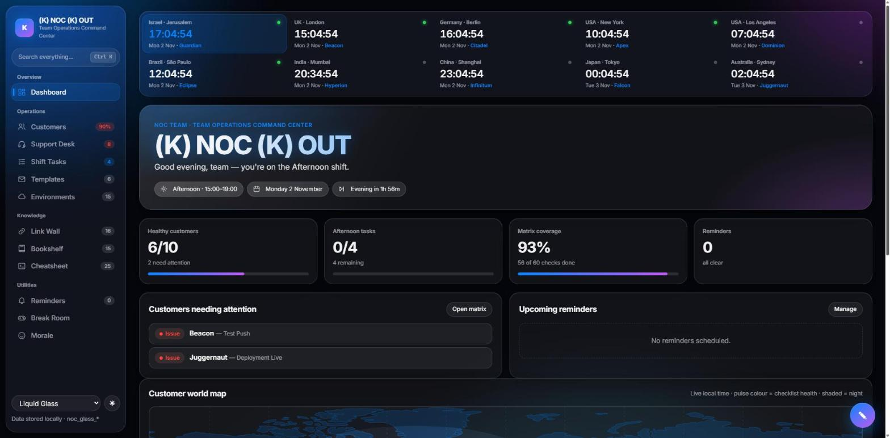
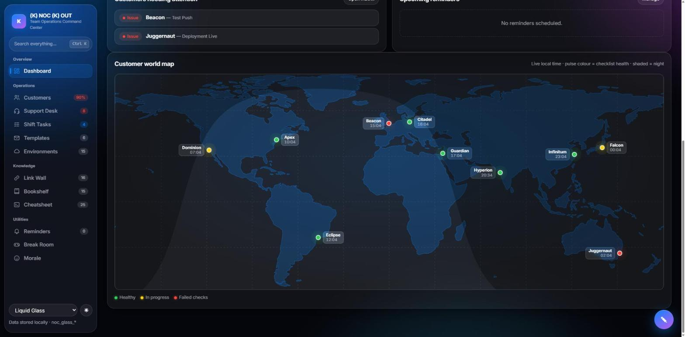
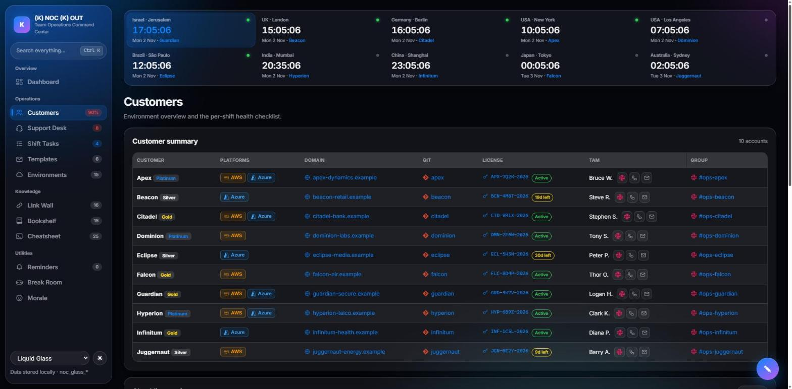
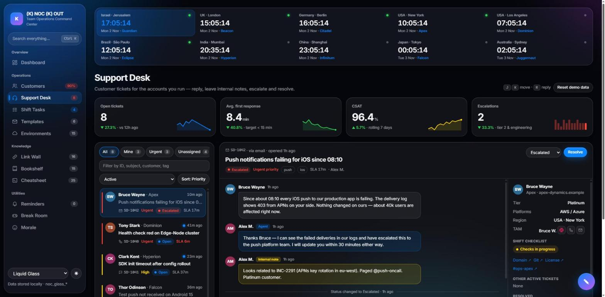
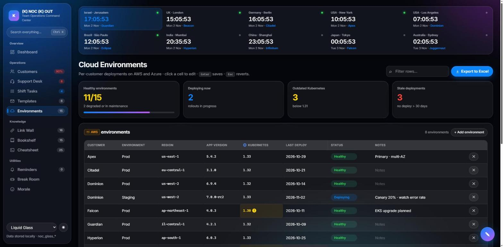
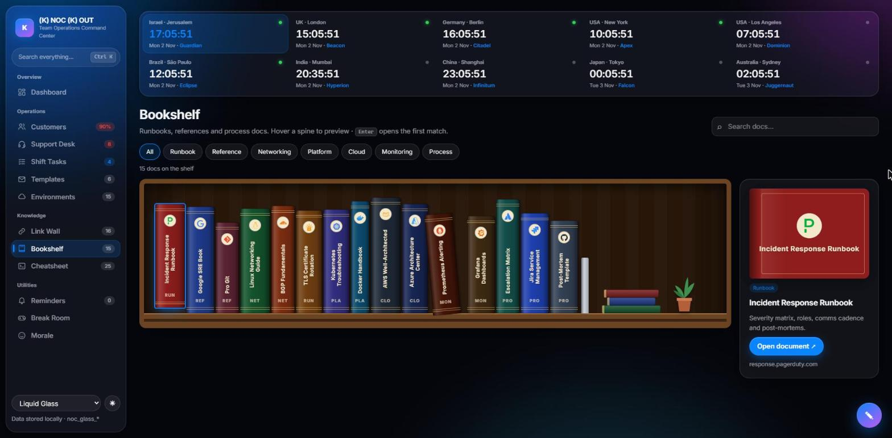
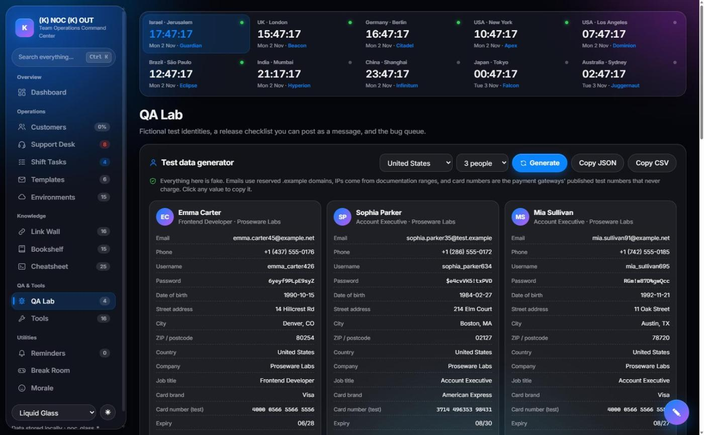
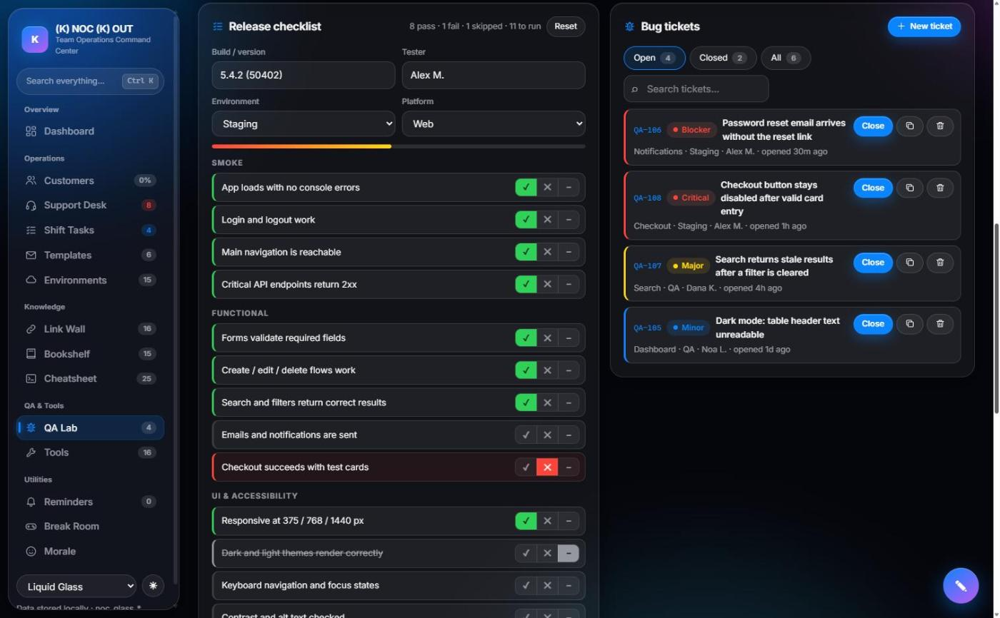
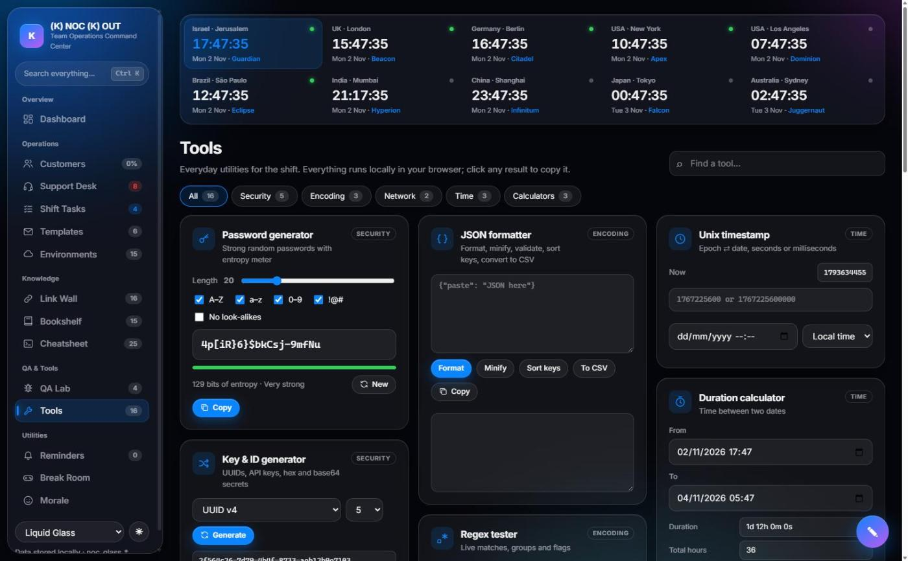
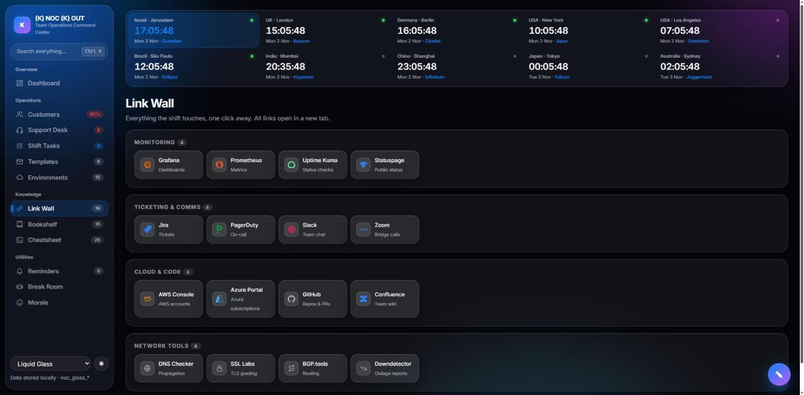

<div align="center">

# (K) NOC (K) OUT

**A command center for Network Operations Center teams, built as one HTML file with no framework.**

Shift handoffs, customer health, cloud environments, a ticket desk, runbooks and world clocks, all on one screen.




</div>

---

## Why this project exists

A NOC engineer starting a shift usually has ten tabs open. There's Grafana for metrics, Jira for tickets, Slack for the customer channels, a spreadsheet of app versions, a wiki page of runbooks, a sticky note with the handoff, and a mental note that it's already 02:00 in Sydney. Context switching is where incidents get missed.

**(K) NOC (K) OUT puts the whole shift in one place:**

- **Who needs attention right now?** The customer health matrix, the world map and the dashboard KPIs answer this at a glance.
- **What is running where?** The Cloud Environments tracker shows every AWS and Azure deployment, and flags outdated Kubernetes versions and stale deploys.
- **Who do I call?** Every customer row links to their domain, Git repo and license, plus the TAM's Slack, phone and email, plus the customer's Slack channel.
- **What did the last shift leave me?** Shift task lists and a handoff generator turn the shift into a report you can paste.
- **How do I fix it?** The bookshelf of runbooks, the link wall and a terminal cheatsheet are one click or one `Ctrl+K` away.

It is also a portfolio piece. It shows how far plain HTML, CSS and JavaScript can go without React, a bundler or a backend.

> All customers, people, domains and tickets are fictional. Customer domains use the reserved `.example` TLD.

---

## Tour

### Dashboard: the shift at a glance
A greeting that knows your shift, a countdown to the next handoff, and live KPI cards. Below them is a list of customers with failed checks. Ten world clocks sit at the top of every page. Each clock shows its business-hours status and the customers based in that zone.

### Customer world map
Each customer region gets a pulsing pin. The pin color follows the health checklist (green: healthy, amber: in progress, red: failed checks) and the label shows the local time. Night is shaded and updates every minute. The coastlines come from a TopoJSON file that a ~25-line hand-written decoder parses. No d3 and no map library are used.



### Customers: every account, every contact
Platform tags with AWS and Azure logos, the customer domain, the Git repo, and the license key with an expiry badge (*Active*, *19d left*, *Expired*). The TAM column has one-click Slack, phone (`tel:`) and email (`mailto:`) buttons, and the Group column links to the customer's Slack channel. Below the table is a 3-state checklist matrix (None → ✓ → ✕) that feeds the dashboard, the map and the handoff report.



### Support Desk
A ticket workspace for the same customers. It has KPI cards with SVG sparklines, quick views (All / Mine / Urgent / Unassigned), live SLA countdowns, and a conversation view with agent replies, internal notes and quick-reply macros. The side panel shows the customer's region, platforms, TAM contacts and current checklist health.



### Cloud Environments
Per-customer deployment tables for AWS and Azure: environment, region, app version, Kubernetes version, last deploy, status and notes. Every cell can be edited inline and saved. Risky cells are flagged automatically: Kubernetes below the supported minor version shows amber, and no deploy in more than 30 days shows red. The **Export to Excel** button lazy-loads SheetJS and writes one sheet per cloud, with a Risks column. If SheetJS can't load, the page exports a CSV instead.



### Bookshelf
Runbooks and references shown as a real wooden bookcase. Each spine carries the brand logo of its topic: Kubernetes, Docker, AWS, Azure, Git, Jira, Grafana, Prometheus and others. Spine heights come from the title length, so the shelf looks hand-stacked but never reshuffles. Hovering a spine pulls the book out and previews it on the reading desk. Search dims the books that don't match and highlights the ones that do.



### QA Lab
A workbench for release testing:
- **Test data generator:** realistic fictional people for 4 locales (US, UK, Israel, Germany) with name, email, phone, address, date of birth, company, password, IP and UUID. Card fields use only the payment gateways' published test numbers. Click any value to copy it, or copy the whole set as JSON or CSV.
- **Release checklist:** Smoke, Functional, UI, Regression and Security groups, each item marked Pass, Fail or Skip. Build, tester, environment and platform are recorded, and the result exports as a ready-to-paste message for **Slack / Teams**, **Jira** (wiki markup) or plain text, including the open bugs.
- **Bug tickets:** open a ticket with severity, component, environment, assignee and repro steps, then close, reopen, copy or delete it. Open / Closed / All views with search, and the open count shows in the sidebar badge.




### Tools
16 everyday utilities in a searchable, filterable masonry grid. Everything runs locally in the browser and every result copies on click.

| Category | Tools |
|---|---|
| **Security** | Password generator with entropy meter · Key & ID generator (UUID, hex / Base64URL secrets, API keys, PINs) · Hash generator, SHA-1/256/384/512 for text or files, with verify · AES-256-GCM encrypt / decrypt (PBKDF2) · JWT decoder with expiry check |
| **Encoding** | Base64 / Base64URL / URL / Hex / HTML encode-decode (UTF-8 safe) · JSON formatter (format, minify, sort keys, validate with line and column, JSON → CSV) · Regex tester with live highlights and groups |
| **Network** | Subnet calculator (network, mask, wildcard, broadcast, host range and address type) with random IPs from the subnet or the private ranges · Random port picker that avoids well-known ports, plus a common-ports lookup |
| **Time** | Time zone converter across all dashboard zones, DST-aware · Unix timestamp ⇄ date · Duration calculator |
| **Calculators** | Percentage (of, ratio, change, ±) · SLA / uptime downtime budget · Data transfer time and size units |



### Link Wall and Cheatsheet
The tools a shift lives in (Grafana, Prometheus, Jira, PagerDuty, Slack, Zoom, AWS Console, Azure Portal, GitHub, Confluence), each with its real logo. The terminal cheatsheet groups battle-tested commands by Network, Linux, Logs, Docker and Kubernetes, with live filtering and a copy button on every command.



### Also included
- **Shift Tasks:** four shift columns. Checking a task records when it was done, and a handoff generator combines tasks, the matrix and your notes.
- **Templates:** click-to-copy incident and maintenance messages with `{customer}`, `{service}`, `{ticket}` and `{time}` placeholders.
- **Reminders:** one-off or repeating timers with a WebAudio triple beep, snooze, and countdowns in the sidebar.
- **Break Room:** 2048 and a Memory Match game played with DevOps logos, both with saved best scores.
- **Command palette (`Ctrl+K`):** searches sections, customers, tickets, bugs, tools, links, docs, commands and templates.
- **Scratchpad:** a draggable, resizable, autosaving notes window.
- **Themes:** "Liquid Glass" frosted panels, 4 accent themes and a light mode.

---

## Technical highlights

| | |
|---|---|
| **Zero framework** | Plain ES2020 and native DOM APIs. One `index.html` file with no `node_modules` and no build. |
| **Config-driven UI** | Every row, card, link, clock and book is rendered from the `SITE` object. The HTML contains only empty section shells. |
| **Hand-written TopoJSON decoder** | Decodes delta-encoded, quantized arcs into SVG paths, and splits rings that cross the antimeridian so Russia and Fiji don't streak across the map. |
| **Day/night terminator** | Computes the solar declination and sub-solar longitude, then draws the night polygon in an equirectangular projection. |
| **Inline editing** | `contenteditable="plaintext-only"` with a fallback that strips pasted HTML. Enter saves, Esc reverts, and saves are debounced to `localStorage`. |
| **Risk engine** | Compares semantic versions and computes deploy age to flag cells and update the KPIs live while you type. |
| **Web Crypto everywhere** | Random values use `crypto.getRandomValues` with rejection sampling, so there is no modulo bias. Hashing and AES-GCM use `crypto.subtle`, and nothing leaves the browser. |
| **Lazy dependencies** | SheetJS loads only on the first export and falls back to CSV. Map coastlines are fetched once and cached in memory. |
| **Brand marks without emoji** | Logos are inline SVG paths from [Simple Icons](https://simpleicons.org) (CC0), stored in a `BRANDS` registry and referenced by key from the config. |
| **Security** | Every dynamic string passes through `esc()` before it reaches `innerHTML`, and URLs go through a `safeUrl()` allow-list (`https:`, `mailto:`, `tel:`). |
| **Persistence** | All state (matrix, tasks, environments, tickets, reminders, notes, theme) is stored in `localStorage` under one prefix. |

## Architecture

- **Numbered modules:** the script is split into `// --- N. Name ---` blocks: config, helpers, toasts, theme engine, routing, state, then one block per feature.
- **State:** saved to `localStorage` under `SITE.storagePrefix` (`noc_glass_` by default).
- **Theme engine:** each theme is a `body.theme-*` class that redefines the color tokens. Light mode overrides only the surface and text tokens.
- **Icons:** `icon(key)` draws line icons and `brand(key)` draws logos. `mark(key)` uses the logo when one exists and falls back to the line icon.

## Customization

Edit `SITE` at the top of the script in `index.html`:

```js
customers:   [{ id, name, persona, tier, platforms /* 'AWS' | 'Azure' */, domain, zone /* timezones id */,
                git, license, licenseExpires, manager /* TAM */, tam: { slack, phone, email }, group /* Slack channel */ }]
timezones:   [{ id, label, tz, lat, lon, pos, primary }]      // lat/lon place the map pin, pos = label side
gitBase / licenseBase / slackBase                             // prefixes that turn repo, license and Slack handles into links
worldMapUrl                                                   // TopoJSON land file for the world map
checklistColumns: [{ id, label }]
envTables / envColumns / envStatuses / environments          // cloud environment tables + seed rows
envRules:    { k8sMinSupported, staleDays }                   // risk-flag thresholds
shifts:      [{ id, name, icon, start, end, tasks: [{ time, text }] }]
support:     { agent, macros, kpi, tickets: [{ id, customer, subject, priority, status, channel, tags, assignee, ageMin, slaInMin, thread }] }
templates:   [{ id, title, tag, body }]                       // {customer} {service} {ticket} {time}
linkGroups:  [{ group, items: [{ name, brand | icon, url, desc }] }]
docs:        [{ title, cat, brand, color, url, desc }]        // brand = spine logo, color = spine leather
commands:    [{ group, icon, items: [{ cmd, desc }] }]
memoryIcons: ['jira', 'git', ...]                             // BRANDS keys used by Memory Match
qa:          { locales, testCards, fields, checklist, severities, components, tickets }   // QA Lab data
toolCategories / tools / commonPorts                          // Tools grid order, categories and port lookup
themes / jokes / gallery / shortcuts
```

## Run and deploy

Open `index.html` in a browser. There is no build step.

- **Vercel:** import the repo at [vercel.com/new](https://vercel.com/new), set **Framework Preset = Other**, leave Build Command and Output Directory empty, and click **Deploy**. `.vercelignore` limits the deployment to the dashboard itself.
- **GitHub Pages:** deploy from the branch root. All paths are relative, so it also works from a sub-path.

## Keyboard shortcuts

`Ctrl/⌘+K` command palette · `Esc` close overlays · `Alt+N` scratchpad · `/` search the current page · `Alt+L` light mode · `Alt+R` new reminder · `Alt+B` test beep · arrows or `WASD` play 2048 · `←` `→` gallery · `J` / `K` move through the Support Desk queue and `R` replies. All shortcuts are configured in `SITE.shortcuts`.

## Credits

- Brand logos: [Simple Icons](https://simpleicons.org) (CC0). The logos are trademarks of their respective owners and are used here only to identify each tool.
- Coastlines: [world-atlas](https://github.com/topojson/world-atlas) (Natural Earth, public domain).
- Excel export: [SheetJS](https://sheetjs.com).
